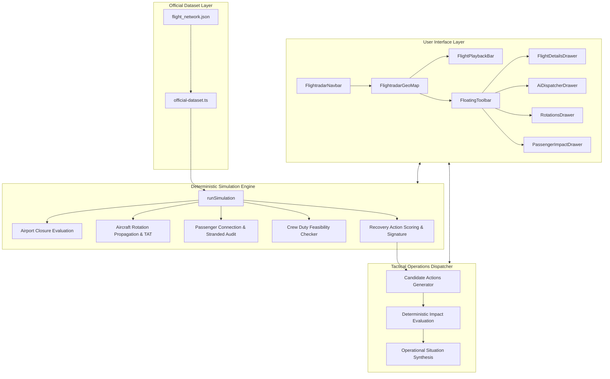

# DOMINO SKY — Airline Network Disruption & Recovery Simulator

**DOMINO SKY** is a production-grade, interactive airline network disruption and operational recovery platform inspired by professional aviation radar systems (such as Flightradar24) and Palantir Foundry operations intelligence.

It models the complex cascading "domino effect" of network disruptions across aircraft rotations, turnaround buffers, passenger minimum connection times (MCT), crew Flight Duty Period (FDP) limitations, and standby spare aircraft allocation across India's domestic airspace.

---

## 1. Core Capabilities

- **Interactive Geospatial Radar Viewport**: Full-screen WebGL map powered by MapLibre GL JS and OpenFreeMap Dark vector tiles, rendering real Indian topography, coastlines, state boundaries, 16 commercial airport hubs, and great-circle flight arcs.
- **Dynamic Airborne Tracking**: Airborne aircraft track along spherical great-circle arcs with continuous position interpolation and heading-aligned 3D-style silhouette icons.
- **Deterministic Disruption Engine**: 100% reproducible simulation engine modeling ground stops, severe convective weather, runway closures, and downstream rotational propagation without synthetic approximations.
- **Why Is This Flight Delayed? (Causal Traceability)**: Complete chronological inspection of primary vs. rotational delay causes, minimum turnaround compliance, and previous aircraft leg history.
- **Passenger MCT & Stranded Analysis**: Exact calculation of connecting passenger layover windows against airport MCT thresholds, distinguishing missable connections from stranded overnight travelers without double-counting.
- **Regulatory Crew Duty Feasibility**: Direct tracking of accumulated duty time from rostered report times against the 600-minute domestic multi-sector maximum crew duty limit.
- **Tactical AI Dispatcher**: Recommendation engine that deterministically evaluates candidate recovery interventions (deploying standby spares `VT-DS17` at BLR or `VT-DS18` at DEL, or tactical cancellations) and ranks them by net delay minutes, stranded passengers, and crew breaches saved.
- **Temporal Playback & Scrubber**: Real-time operational clock with scrubbing, playback speed multipliers (1x, 2x, 5x, 10x), step controls (+/- 15m), and disruption window markers.

---

## 2. Technology Stack

- **Framework**: Next.js 16 (App Router, Turbopack)
- **UI & State**: React 19, TypeScript 5, Tailwind CSS 4
- **Geospatial & Vector Mapping**: MapLibre GL JS, OpenFreeMap Dark vector tiles
- **Analytics & Telemetry**: Recharts, Lucide Icons
- **Simulation & Testing**: Custom deterministic engine, TSX test runner, ESLint 9

---

## 3. Dataset Specification

The application integrates the official organiser flight network dataset ([`src/data/flight_network.json`](src/data/flight_network.json)) as its authoritative single source of truth:

| Entity | Quantity | Key Details |
|---|---|---|
| **Commercial Airports** | 16 | DEL, BOM, BLR, HYD, MAA, CCU, AMD, COK, GOI, PNQ, JAI, GAU, LKO, IXC, BBI, TRV |
| **Operating Aircraft** | 16 | Tail numbers `VT-DS01` through `VT-DS16` (Airbus A320neo, 180 seats) |
| **Standby Spare Aircraft** | 2 | `VT-DS17` (based at BLR, available from 05:00), `VT-DS18` (based at DEL, available from 05:00) |
| **Scheduled Flights** | 70 | Flight numbers `DS0101` through `DS1604` across multi-sector daily rotations |
| **Passenger Connections** | 21 | Hub layovers `CX01` through `CX21` with explicit minimum connection times (45m) |
| **Crew Pairings** | 16 | Rosters `CR01` through `CR16` with 600-minute maximum duty limit |
| **Minimum Turnaround (TAT)** | 30m | Aircraft turn buffer required between consecutive legs |

---

## 4. Architecture Overview



---

## 5. Project Structure

```
domino-sky/
├── public/                       # Static public assets
├── src/
│   ├── app/
│   │   ├── api/
│   │   │   └── ai-dispatcher/    # Dispatcher briefing API endpoint
│   │   ├── globals.css           # Theme colors, scrollbars, MapLibre styles
│   │   ├── layout.tsx            # Root layout
│   │   └── page.tsx              # Main radar cockpit and drawer coordinator
│   ├── components/
│   │   ├── airport-details/      # Airport telemetry inspector drawer
│   │   ├── analytics/            # Recharts network KPI charts
│   │   ├── dataset/              # Dataset manager & importer modal
│   │   ├── disruption-panel/     # Disruption workbench drawer
│   │   ├── flight-details/       # "Why is this flight delayed?" inspector drawer
│   │   ├── gantt/                # 16-aircraft rotation Gantt drawer
│   │   ├── navigation/           # Top navbar, floating toolbar, filters
│   │   ├── network-map/          # FlightradarGeoMap (MapLibre GL implementation)
│   │   ├── recovery-panel/       # AI Dispatcher drawer & before/after compare modal
│   │   ├── timeline/             # Playback bar, time scrubber, speed controls
│   │   └── views/                # Passenger impact drawer
│   ├── data/
│   │   ├── flight_network.json   # Authoritative organiser dataset
│   │   └── official-dataset.ts   # Strongly typed data loader
│   ├── engine/
│   │   ├── aircraft-rotation.ts  # Turnaround and rotation cascading delay engine
│   │   ├── airport-closure.ts    # Ground stops and weather hold logic
│   │   ├── crew-constraints.ts   # 600m max crew duty auditor
│   │   ├── geo-utils.ts          # Spherical slerp, bearing, great-circle line generator
│   │   ├── metrics.ts            # Summary metrics and deterministic signatures
│   │   ├── passenger-connections.ts # MCT and stranded traveler audit
│   │   ├── recovery.ts           # Tactical actions evaluator
│   │   ├── simulation.ts         # Master simulation orchestrator
│   │   └── time-utils.ts         # Time math and formatters
│   ├── services/
│   │   ├── ai-dispatcher.ts      # Candidate ranking & operations synthesis
│   │   └── dataset-loader.ts     # Dynamic JSON import parser
│   ├── tests/
│   │   └── simulation-engine.test.ts # 13/13 automated technical audit suite
│   └── types/
│       └── aviation.ts           # Complete TypeScript domain contracts
├── .gitignore
├── eslint.config.mjs
├── package.json
├── tsconfig.json
└── README.md
```

---

## 6. Installation & Quick Start

### Prerequisites
- Node.js 18.18+ or Node.js 20+ (recommended: Node.js 20 LTS or Node.js 22 LTS)
- npm 9+ or pnpm 8+

### Setup
```bash
# 1. Clone repository
git clone <repository-url>
cd domino-sky

# 2. Install dependencies
npm install

# 3. Run the automated technical audit test suite
npm test

# 4. Start the local development server
npm run dev
```

Navigate to `http://localhost:3000` in your web browser.

---

## 7. Production Build & Verification

```bash
# Run TypeScript compilation and strict static type checking
npx tsc --noEmit

# Run ESLint validation
npm run lint

# Build optimized production bundle
npm run build

# Start the production server locally
npm start -- -p 3000
```

---

## 8. Automated Audit Test Suite

Execute the 13 automated technical audit checks against the official dataset:

```bash
npm test
```

Expected output:
```
====================================================
   DOMINO SKY - RIGOROUS ENGINE TECHNICAL AUDIT    
====================================================

[PASS] Audit 1: Dataset integrity (16 Airports, 16 Aircraft, 70 Flights, 2 Spares, 21 Connections)
[PASS] Audit 2: Nominal clear-weather schedule has 0 crew breaches and 0 delays
[PASS] Audit 3: Airport closure delays appropriate flights scheduled in window
[PASS] Audit 4: Delay propagates through aircraft rotation to clear-weather airports
[PASS] Audit 5: Turnaround requirements (TAT >= 30m) strictly respected
[PASS] Audit 6: Passenger connections evaluated with MCT and stranded logic
[PASS] Audit 7: Passenger totals strictly match booked capacity without double counting
[PASS] Audit 8: Disruption triggers confirmed DGCA duty breach (exceeding 600m max duty)
[PASS] Audit 9: Simulation time isolation: future 14:00 disruption produces 0 active delay at 06:00
[PASS] Audit 10: Dispatcher correctly rejects ineffective recovery actions (0m saved)
[PASS] Audit 11: Dispatcher recommends effective spare at clear-weather hub (saves delay, fixes crew breach)
[PASS] Audit 12: Tactical cancellation isolates rotational cascade
[PASS] Audit 13: Identical inputs produce bitwise identical signatures and outputs

====================================================
   AUDIT RESULTS: 13 / 13 PASSED (100%)
====================================================
```

---

## 9. Map Provider & Attribution

- **Basemap Engine**: MapLibre GL JS
- **Vector Tiles**: [OpenFreeMap](https://openfreemap.org/) Dark Style (`https://tiles.openfreemap.org/styles/dark`)
- **Map Data Attribution**: Map data © [OpenStreetMap](https://www.openstreetmap.org/copyright) contributors, style and tiles © [OpenMapTiles](https://openmaptiles.org/) and OpenFreeMap.

---

## 10. Environment Variables

This application is fully client-side and edge-compatible. No mandatory external API keys are required to run the simulation or view the map.

Optional environment variables can be configured in `.env.local`:
```env
# Optional LLM API Key for real-time generative dispatcher briefings (falls back gracefully to built-in deterministic briefings)
GEMINI_API_KEY=your_gemini_api_key_here
```

---

## 11. Known Operational Boundaries

- **Single Operating Day**: The dataset models a 24-hour operational day (00:00 to 24:00 IST). Rotations wrapping into the next calendar day are tracked up to schedule termination.
- **Domestic Sectors**: All 70 sectors operate between the 16 domestic Indian airports specified in `flight_network.json`.
- **Standby Spare Bases**: Spare aircraft availability is constrained to their station bases (`VT-DS17` at BLR and `VT-DS18` at DEL) from 05:00 IST onwards per dataset parameters.

---

## 12. License

Domino Sky is released under the MIT License.
